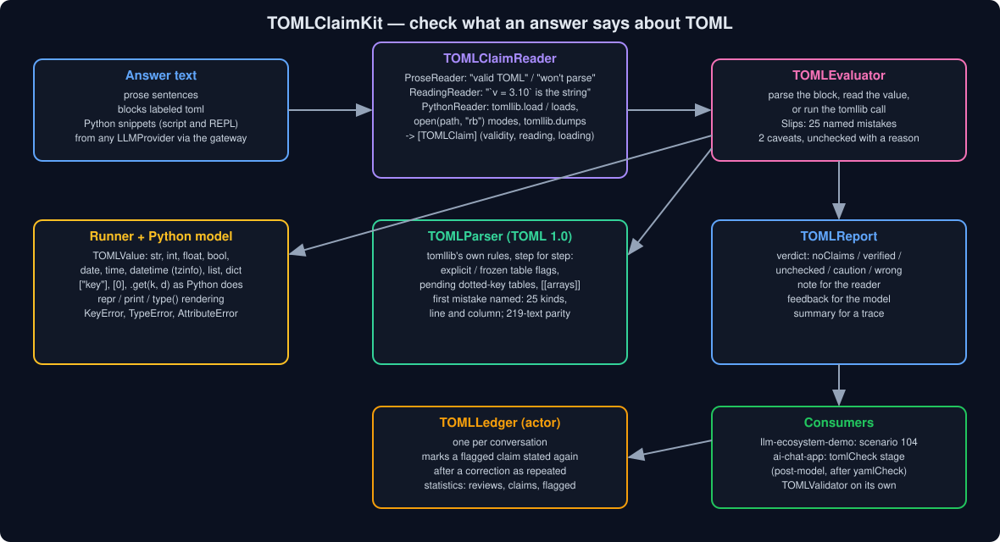
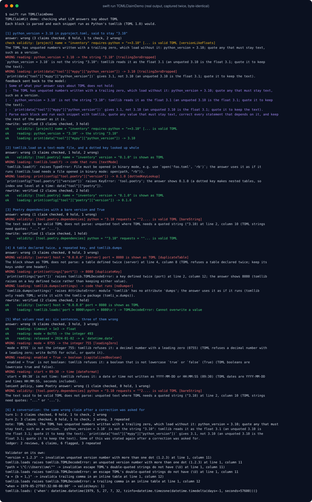
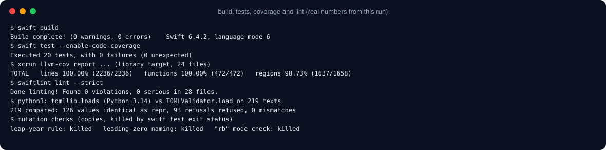

# TOMLClaimKit



Ask a model to set up mypy in `pyproject.toml` and it writes `python_version = 3.10`, then says mypy
gets "3.10". It gets the float `3.1`: unquoted, `3.10` is a number in TOML. Ask how to read the file and
it writes `with open("pyproject.toml") as f: tomllib.load(f)`, which raises `TypeError` because `tomllib`
only reads files opened with `"rb"`. Ask for the package version and it looks up
`data["tool.poetry"]`, which raises `KeyError`: the header `[tool.poetry]` made two nested tables. Ask for
Poetry dependencies and it writes `python = ^3.10` and `debug = True`; `tomllib` refuses both. Ask how to
save a change and it calls `tomllib.dumps`, which does not exist.

Each of those reads like a right answer, and each can be checked. TOMLClaimKit reads what an answer says
about TOML (that a text is valid TOML, what a value reads as, what `tomllib.load` or `tomllib.loads`
returns in a Python snippet) and checks each claim the way Python's own `tomllib` would. It says which
claims hold, which hold with something to look at again, and which are wrong, with what really comes out
and, where it can tell, the mistake behind it.

## Why

The series' claim checkers rerun what an answer works out on its own: dates, arithmetic, units, regexes,
strings, JSON and, since `YAMLClaimKit`, YAML. TOML is the other config format answers write all the
time, for `pyproject.toml`, `Cargo.toml`, Hugo and Netlify settings. It fails differently from YAML. YAML
accepts almost anything and reads it wrongly; TOML refuses a lot that looks fine (`True`, `0755`, `1.2.3`,
`.5`, `10:30`, `"C:\Users"`, a key or table written twice) and quietly turns the rest into types the
answer did not mean (`3.10` into 3.1, `2024-01-02` into a `datetime.date`). The Python side has its own
traps: binary mode, no writer in the standard library, and dotted keys that are not keys.

## What it checks

| Claim | Where it comes from | Checked by |
|---|---|---|
| **validity** | "The block below is valid TOML", "this won't parse", every block labeled `toml` | parsing it with `tomllib`'s rules and naming the first mistake with its line and column |
| **reading** | "`python_version = 3.10` is read as the string "3.10"", "`1e3` is not an integer", "tomllib loads `released = 2024-01-02` as a `datetime.date`" | reading the value after `=` as `tomllib` does |
| **loading** | Python snippets: a comment after the expression, comment lines after a `print`, or REPL output; `tomllib.load(f)`, `tomllib.loads(text)`, `["key"]`, `[0]`, `.get(k, default)`, `type(...)` | running the call: the file's mode, the TOML block shown before the snippet, then Python's indexing |

A call that always raises (`tomllib.load` on a text-mode file or a path, `tomllib.dumps`) is a claim on its
own: the answer shows it as code that runs. A loading claim reads the TOML block shown before the snippet
when the snippet opens a file or calls `.read()`; `textwrap.dedent` and names bound to strings are followed.

### The slips it names

| Slip | What happened |
|---|---|
| `bareString` | unquoted text (`python = ^3.10`) where TOML needs quotes |
| `capitalizedBoolean` | `True` or `TRUE`; TOML booleans are lowercase |
| `noNull` | `null`, `None` or `~`; TOML has no null |
| `leadingZero` | `0755`; TOML refuses a leading zero (`0o755` is octal) |
| `unquotedVersion` | `1.2.3` unquoted |
| `floatDot` | `.5` or `5.`; a float needs digits on both sides of the dot |
| `dateFormat` | `2024-1-2`, `10:30` (no seconds), `24:00:00` |
| `backslash` | `"C:\Users"`: a backslash that is not an escape in a double-quoted string |
| `duplicateKey`, `duplicateTable` | a key or a table defined twice; `tomllib` raises rather than keeping either |
| `inlineTableExtended`, `inlineTableSyntax` | an inline table added to later, or written across lines or with a trailing comma |
| `trailingZeroDropped` | `3.10` taken for "3.10" where TOML reads the float 3.1 |
| `unquotedNumber`, `dateParsed` | an unquoted number or date taken for text |
| `numberType`, `staysString` | an int shown for a float (`1e3` is 1000.0), or a quoted value taken for a number |
| `dottedKeyLookup` | `data["tool.poetry"]` where the dotted key made nested tables |
| `textMode`, `pathArgument` | `tomllib.load` on a text-mode file, or on a path |
| `noDumper` | `tomllib.dumps`; write TOML with the tomli-w package |
| `notTOML`, `parses`, `raises`, `doesNotRaise` | the general cases |

Two caveats are reported for TOML that parses: unquoted floats written with a trailing zero
(`python_version = 3.10`, which loads as 3.1) and dotted keys made of digits (`3.10 = "x"`, which becomes
`{'3': {'10': 'x'}}`).

## Install

```swift
.package(url: "https://github.com/rajatslakhina/toml-claim-kit.git", from: "1.0.0")
```

and `.product(name: "TOMLClaimKit", package: "toml-claim-kit")` in your target. Swift 6, no dependencies.
macOS 13, iOS 16, tvOS 16, watchOS 9.

## Usage

```swift
import TOMLClaimKit

let report = TOMLClaimChecker().check(answer)
switch report.verdict {
case .noClaims, .verified: break
case .unchecked, .caution, .wrong:
    showNote(report.note)              // "TOML check: `python_version = 3.10` is not the string "3.10": …"
    nextTurnFeedback = report.feedback // a message asking the model to redo what it got wrong
}
```

Across a conversation, a `TOMLLedger` (an actor) marks a claim that was flagged before as repeated:

```swift
let ledger = TOMLLedger()
let report = await ledger.review(answer)
report.repeatedCount   // flagged claims already flagged earlier in the conversation
```

The parser works on its own:

```swift
TOMLValidator.validate("version = 1.2.3")  // .invalid(an unquoted version number with more than one dot (1.2.3) at line 1, column 11)
TOMLValidator.load("v = 3.10")             // .value({'v': 3.1}) as tomllib.loads returns it
TOMLValidator.value("2024-01-02")          // .value(datetime.date(2024, 1, 2))
```

### Policies

| Policy | Blocks labeled `toml` | Caveats | Output shown another way |
|---|---|---|---|
| `.standard` | checked | reported | holds (spacing, key order, quote style) |
| `.lenient` | not checked (only stated claims) | let through | holds |
| `.strict` | checked | reported | must match character for character |

## How it fits

- **ProviderGatewayKit** sends the turn; this package checks the answer that comes back. It has no
  compile-time dependency on it: run it on the reply text before the answer is shown.
- **YAMLClaimKit** and **JSONClaimKit** check what an answer says about YAML and JSON; this one covers TOML.
- **OutputRepairKit** runs a bounded repair loop; `report.feedback` is the re-prompt.
- **ai-chat-app** runs it as the `tomlCheck` stage after the model answers.

## Demo



`swift run TOMLClaimDemo` runs six scenarios, each answer followed by the rewrite its feedback asks for:
`python_version = 3.10` in a mypy section, `tomllib.load` on a text-mode file with a `data["tool.poetry"]`
lookup, Poetry dependencies with `^3.10` and `True`, a table declared twice with a repeated key and
`tomllib.dumps`, six sentences about what values read as (three wrong), and a conversation through a
`TOMLLedger` where the same wrong claims come back. The full output is in
[Screenshots/demo-output.txt](Screenshots/demo-output.txt); two runs are byte-identical.

## Quality



- `swift build`: 0 warnings, 0 errors (Swift 6.4.2, language mode 6).
- `swift test --enable-code-coverage`: 20 tests, 0 failures.
- `llvm-cov report` on the library: **100.00% of lines (2236) and functions (472)** in all 24 files;
  regions 98.73% (1637/1658). The missed regions are short-circuit arms and the `else` sides of one-line
  guards that no input reaches; [Screenshots/coverage.txt](Screenshots/coverage.txt) has the full report.
- `swiftlint lint --strict`: 0 violations in 28 files, with the series' `.swiftlint.yml` unchanged.
- Parity with Python 3.14's `tomllib`: `tomllib.loads` was run on 219 texts and its `repr` (or the fact
  that it raised) kept as a test table. All 126 values render identically and all 93 refusals are refused.
  Regenerate the table with `python3 -I Scripts/tomllib-parity.py > Tests/TOMLClaimKitTests/Parity.swift`.
- Mutation checks on three rules, each mutant failing the suite (judged by exit status): the 400-year leap
  rule (`2000-02-29` exists), naming a leading zero, and the `"rb"` mode check.

## Limits

- TOML 1.0, as Python 3.14's `tomllib` reads it. TOML 1.1 additions (`\e`, `\x41`, seconds-free times,
  multi-line inline tables) are refused, as `tomllib` refuses them.
- The error line in an explanation uses this package's wording for the mistake, not `tomllib`'s message.
- Integers too large for 64 bits are reported as unchecked; `tomllib` accepts them.
- Only `tomllib` and `tomli` calls are run. The older `toml` package, `tomlkit`, and Rust or Go code are not
  read; `tomli_w.dumps` output is not modelled.
- Datetimes are compared field by field, so the same instant written with another offset counts as different.
- A sentence is read for one value: the first inline code in it.
- Error claims are matched by kind (any TOML decode error, or the Python exception class), not by message.

## Part of a series

One of a set of Swift packages around
[ProviderGatewayKit](https://github.com/rajatslakhina/foundation-model-provider-gateway); the
[umbrella demo](https://github.com/rajatslakhina/llm-ecosystem-demo) runs them together and
[ai-chat-app](https://github.com/rajatslakhina/ai-chat-app) uses them in a real send pipeline.

MIT license.
